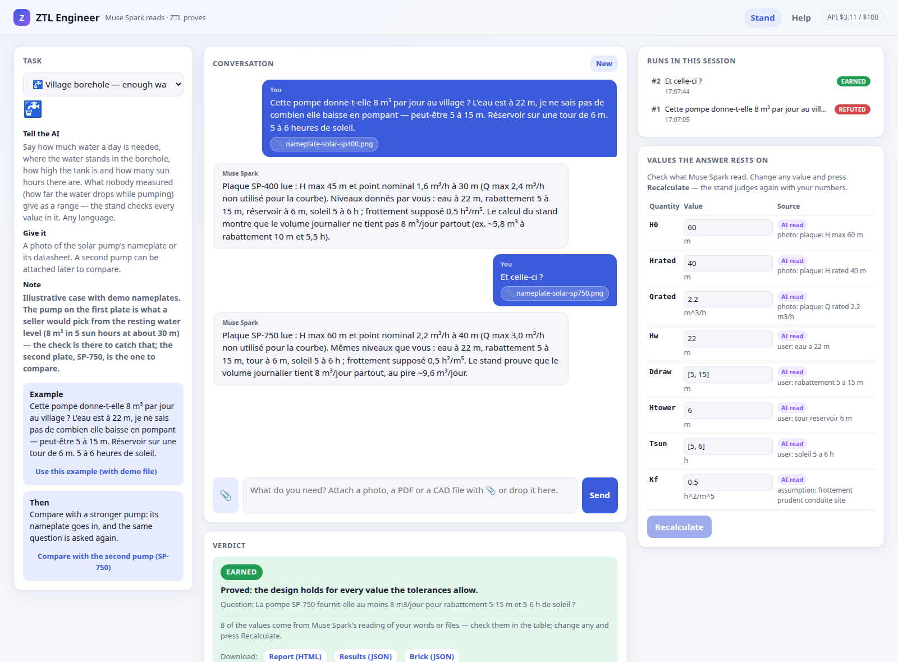

# ZTL Engineer

**An independent check of an engineering promise, for anyone.** Every pump, every solar kit comes with a seller's
promise that it will work. To check it you need an engineer — and in developing countries, by a UNESCO estimate,
there are fewer than five for every ten thousand people. ZTL Engineer lets a technician ask in their own language,
with a phone photo of a nameplate or a datasheet, and get not an opinion but a **proof**: the design holds for every
value the tolerances allow (EARNED), or it fails at a concrete point (REFUTED), or the honest "can't vouch yet" (OPEN).

Meta's **Muse Spark** reads the photos and documents and turns the conversation into a formal design brick; the
**ZTL stand** judges it. Muse Spark calls the stand itself (Responses API function calling): it checks its own
brick, repairs the form on a BRICK ERROR, rewrites the laws on an OPEN — never the data or the question, which the
tool refuses — and a verdict once EARNED or REFUTED is final. What the person sees is always the stand's answer.
Every value the model read is listed with where it came from, marked "AI read"; correct any of them and press
Recalculate to judge again. Every answer downloads as a report and as the stand's own problem file, which anyone can
run again on the open-source stand, with no AI.

*A village borehole, asked in French with a photo of the pump's nameplate. The unmeasured drawdown goes in as a
range (5–15 m); the seller's pump is refuted (2.8–8.2 m³/day against the 8 needed), the second pump is proved
(9.6–14.5 m³/day). The nameplates are demo plates.*

**Try it live: [engineer.vitalyreznik.com](https://engineer.vitalyreznik.com)** (a public demo on a small server:
a few questions an hour per visitor, the heavy tasks off). **Demo video (3 min): [youtu.be/a8-cb6Ng4-g](https://youtu.be/a8-cb6Ng4-g)** Built for the Meta Global AI Developer Hackathon (Oct 26 – Nov 4, 2026),
Indie track.

## What was built during the hackathon, and what was not

**Built during the hackathon (everything in this repository):** the web application; the Muse Spark agent that
reads photos and PDFs and checks its own brick with the stand through function calling, under rules it cannot bend;
the "AI read" values with Recalculate; the CAD road (SPICE netlist + BOM, truss deck) and the proved-range runs; the
task presets with demo files; the reports and downloads; the MCP server; the spending stop; the security hardening;
the help page; and the tooling that recorded the demo video. The repository was created after the kickoff on
Oct 26, 2026; its history is the record.

**Pre-existing, used as dependencies (not hackathon work):**
- [ZTL — Zero-Trust Logic](https://github.com/inventor1975/ZTL) (public since July 2026, Apache-2.0) — the logic
  and judge.
- [ztl-stand](https://github.com/inventor1975/ztl-stand) (public since Oct 20, 2026, Apache-2.0) — the design
  stand that proves or refutes a brick.

Both are by the same author and are installed beside this repository; nothing from them is copied here.

## Run it

Python 3.10+; the app itself uses only the standard library, the stand needs `numpy`, `scipy` and `sympy`; and
`pdftoppm` (poppler-utils) for PDF datasheets. Clone
[ZTL](https://github.com/inventor1975/ZTL) and [ztl-stand](https://github.com/inventor1975/ztl-stand) beside this
repository, put a Meta Model API key in `META_API_KEY` or `~/.config/meta-api-key`, then:

    python3 server.py            # http://localhost:8090

Pick a task (or ask anything), press "Use this example" — it brings its demo file — and Send. A check costs a few
cents of Meta API credit (measured: 2.7 cents a model call on average).

## Use it from any AI agent (MCP)

`mcp_server.py` makes ZTL Engineer an MCP server (stdio, standard library only), so an AI agent can ask for an
independent check before it tells a person "this will work":

- `brick_format` — the stand's brick format, so the agent can write the problem itself;
- `check_design` — the ZTL stand judges a brick: EARNED / REFUTED with a failing point / OPEN; no AI, no API cost;
- `ask_engineer` — the whole road in plain words with files: Muse Spark reads, the stand judges (uses Meta API credit).

For example, in Claude Desktop's `claude_desktop_config.json`:

    {"mcpServers": {"ztl-engineer": {"command": "python3", "args": ["/path/to/ztl-engineer/mcp_server.py"]}}}

## Security

- **The public demo** runs the same code with `ZTL_ENGINEER_PUBLIC=1` (`ztl_engineer/public.py`): its own host name
  only, per-address limits, uploads up to 10 MB, no heavy runs, a $20 spending stop, behind Apache with HTTPS.
- **Local only.** The server listens on 127.0.0.1 and answers only this machine's browser: a request whose Host or
  Origin is not localhost, or a POST that is not JSON, is refused (another web page open in the same browser cannot
  drive it). There are no accounts: do not put it on the internet as it is — anyone who could reach it could read
  sessions and spend the API key's credit (a spending stop, $100 by default, `ZTL_ENGINEER_SPEND_CAP_USD`, is the
  only limit).
- **A brick is data, never code.** Uploaded bricks and the bricks the model writes (a datasheet may carry hidden
  instructions) are checked by the stand before anything reads them: their expressions may be arithmetic over names
  only — no attributes, indexing, strings or other Python (ztl-stand `ustand/safeexpr.py`); a system of components
  may not name files outside its own folder, and one given as data names none.
- **Uploaded files** are stored under `runs/<session>/files/` with a cleaned name (no folders, quotes or line breaks).

## Built with

Muse Spark 1.3 (Meta Model API). The code was written with Claude (Anthropic); the author is Vitaly Reznik.
